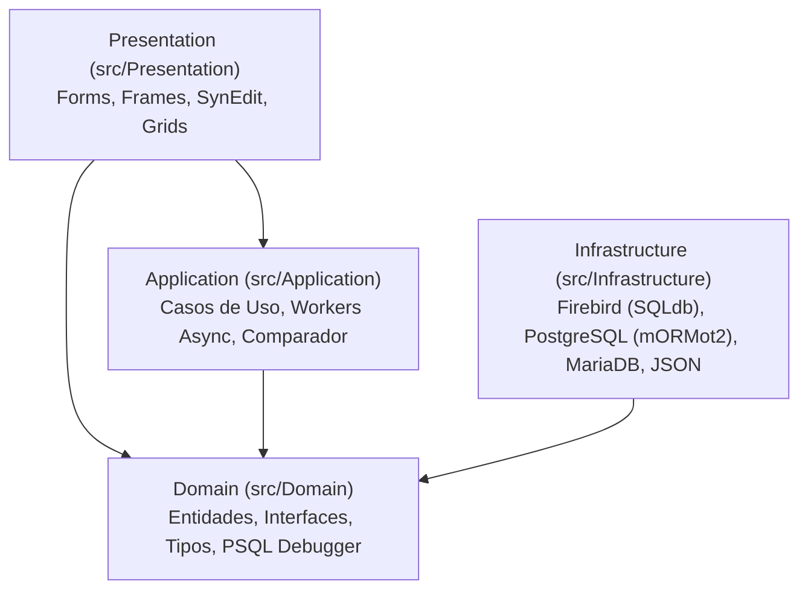

# Arquitetura do Código Fonte — MultiDbSqlEditor

Este documento descreve a organização, as camadas, os módulos e os principais fluxos do **MultiDbSqlEditor** (Free Pascal / Lazarus, compatível com **Firebird**, **PostgreSQL** e **MariaDB**).

---

## 1. Visão Geral (Clean Architecture)

O projeto segue uma separação em **4 camadas**, com dependências apontando sempre para o núcleo (`Domain`):



- **Regra de dependência:**
  - `Domain` não depende de nenhuma camada de UI ou banco.
  - `Application` orquestra regras de negócio usando apenas interfaces de `Domain`.
  - `Infrastructure` implementa as interfaces de `Domain` (`IDatabaseProvider`, `IDatabaseSession`, `IConnectionRepository`).
  - `Presentation` cuida apenas da interface gráfica (LCL / `SynEdit` / `TStringGrid` / `TDrawGrid`).

---

## 2. Estrutura de Diretórios e Units

### 2.1 Domain (`src/Domain/`)

| Unit | Responsabilidade |
| :--- | :--- |
| `Domain.DatabaseTypes.pas` | Enums e tipos básicos (`TDatabaseType`, `TFirebirdVersion`, `TSchemaObjectKind`, etc.). |
| `Domain.ConnectionProfile.pas` | Classe `TConnectionProfile` (`Clone`, `Validate`, `EffectiveDatabase`, `EffectiveSchema`, ambiente/cor de alerta `EnvironmentKind` / `IsProduction`, parser de connection string Firebird). |
| `Domain.Interfaces.pas` | Contratos principais: `IDatabaseSession`, `IDatabaseProvider`, `IDatabaseProviderFactory`, `IConnectionRepository`. |
| `Domain.QueryResult.pas` | `TQueryResult`, `IResultSetCursor` (paginação sob demanda), *disk spill* em `.tmp` com limpeza automática na saída (`CleanupSpillTempFiles`), `CloneSnapshot`, proteção de memória RAM do SO (`GetSystemMemoryInfo`) e estatísticas de performance. |
| `Domain.PsqlDebugger.pas` | **Interpretador / Debugger PSQL Firebird** (tokenizer, AST, pilha de frames, avaliador de expressões, breakpoints, captura de campos e `SUSPEND`). |
| `Domain.ExplainPlanParser.pas` | Parser visual de planos de execução (Firebird texto, PostgreSQL JSON e MariaDB JSON). |
| `Domain.QueryHistory.pas` | Modelos e contrato do histórico de execução de queries. |
| `Domain.SqlBeautifier.pas` | Formatador/indentador de código SQL. |
| `Domain.DatabaseCompareTypes.pas` | Modelos de comparação de schemas (`TCompareOptions`, `TCompareDiffItem`, `TCompareResult`, categorias e status). |
| `Domain.TableStructureTypes.pas` | Estruturas de tabela (`TTableStructure`, `TTableColumnInfo` com `Description`, `TTableIndexInfo`, `TTableForeignKeyInfo`, `UniqueConstraints`, `CheckConstraints`). |
| `Domain.SqlAliasResolver.pas` | Extração de aliases SQL para autocompletar inteligente. |
| `Domain.TableDdlBuilder.pas` | Geração pura de DDL de tabelas, colunas, índices e triggers por SGBD. |
| `Domain.SqlScriptUtils.pas` | Divisor de scripts SQL (`SET TERM`, `$$`, comentários) e normalização de código. |
| `Domain.AppLogger.pas` | Logger diagnóstico cross-platform (Windows/Linux), thread-safe, com rotação e ring-buffer. |
| `Domain.AppVersion.pas` | Versão da aplicação, comparação SemVer e parser de releases do GitHub. |
| `Domain.ScriptExecutionTypes.pas` | Tipos de execução em lote para o Script Executive. |
| `Domain.MonitoringTypes.pas` | Tipos do monitor de conexões e transações ativas. |
| `Domain.MaintenanceTypes.pas` | Tipos de Backup / Restore / Repair. |

---

### 2.2 Application (`src/Application/`)

| Unit | Responsabilidade |
| :--- | :--- |
| `Application.ManageConnectionsUseCase.pas` | CRUD e reordenação de perfis de conexão (`Save`, `Delete`, `Reorder`, `ListAll`). |
| `Application.TestConnectionUseCase.pas` | Teste de conectividade antes de salvar uma conexão e listagem de schemas PostgreSQL (`ListPostgresSchemas`). |
| `Application.ExecuteQueryUseCase.pas` | Execução de consultas SQL em sessão ativa. |
| `Application.AsyncQueryRunner.pas` | Thread em background para execução assíncrona de queries no editor SQL. |
| `Application.GridDmlHelper.pas` | Geração e execução de DML (`INSERT`, `UPDATE`, `DELETE`) para edição inline no grid de resultados. |
| `Application.BrowseSchemaUseCase.pas` | Leitura de objetos do banco (tabelas, views, procedures, triggers, generators) e listagem de bancos PostgreSQL (`ListPostgresDatabases`) para o TreeView. |
| `Application.ManageTableStructureUseCase.pas` | Leitura/alteração de estrutura de tabelas, exclusão (`DropTable`) e helpers de DDL. |
| `Application.ManageDatabaseObjectsUseCase.pas` | Extração de DDL, compilação/alteração, exclusão (`DropObject`), metadados de procedures (`LoadProcedureMetadata`), execução (`ExecuteProcedure`) e `QuoteDbIdent`. |
| `Application.DatabaseComparerUseCase.pas` | **Database Comparer:** captura snapshot em lote, ordena Views/Procedures por dependência (`SortCodeItemsByDependency`), gera script de migração e aplica em transação única via `TApplyCompareScriptWorker`. |
| `Application.ScriptExecutorUseCase.pas` | Execução de scripts multi-comando (com suporte a `SET TERM` no Firebird). |
| `Application.DatabaseMonitoringUseCase.pas` | Consulta e encerramento de sessões/transações ativas no banco. |
| `Application.DatabaseMaintenanceUseCase.pas` | Orquestração de Backup, Restore e validação/correção (via `IFirebirdMaintenanceServiceFactory`). |
| `Application.CheckUpdateUseCase.pas` | Verificação de atualizações em background e preferências (`update_settings.json`). |

---

### 2.3 Infrastructure (`src/Infrastructure/`)

| Unit | Responsabilidade |
| :--- | :--- |
| `Infrastructure.ProviderFactory.pas` | Seleciona o `IDatabaseProvider` adequado (`dtFirebird`, `dtPostgreSQL` ou `dtMariaDB`). |
| `Infrastructure.FirebirdSqlDbProvider.pas` | Provedor Firebird via `SQLdb` (`TIBConnection` / `TSQLQuery`), carregamento dinâmico de `fbclient.dll` (2.5 a 5.0, win32/win64), cursor paginado, plano de execução e contadores de I/O. |
| `Infrastructure.MormotPostgresProvider.pas` | Provedor PostgreSQL via **mORMot2** (`libpq.dll`), com suporte a `EffectiveDatabase` (`postgres` quando vazio). |
| `Infrastructure.MariaDbSqlDbProvider.pas` | Provedor MariaDB/MySQL via `SQLdb` (`libmariadb.dll`). |
| `Infrastructure.FirebirdServicesRunner.pas` | Integração com serviços de manutenção Firebird (Backup/Restore/Repair). |
| `Infrastructure.JsonConnectionRepository.pas` | Persistência das conexões em JSON (`connections.json`), incluindo `environmentKind`. |
| `Infrastructure.JsonQueryHistoryRepository.pas` | Persistência do histórico de queries executadas. |
| `Infrastructure.JsonWorkspaceRepository.pas` | Persistência das abas abertas e layout em `workspace.json`. |
| `Infrastructure.GitHubUpdateService.pas` | Consulta à API do GitHub Releases via `mORMot2` (`HttpGet`) com fallback `curl` (Windows/Linux). |

---

### 2.4 Presentation (`src/Presentation/`)

| Unit | Responsabilidade |
| :--- | :--- |
| `Presentation.MainForm.pas` / `.lfm` | Janela principal, árvore de conexões (com expansão multi-banco no PostgreSQL, cores por ambiente e dupla confirmação na exclusão de tabelas), gerenciamento de abas (`pgEditors`) e atalhos globais. |
| `Presentation.TabHelpers.pas` | Helpers multiplataforma para exibir o sufixo `×` nas abas no Windows (`LCLwin32`) sem poluir os títulos internos. |
| `Presentation.SqlEditorFrame.pas` / `.lfm` | Editor SQL com `TSynEdit`, autocompletar (`Ctrl+Espaço`), `Ctrl+Click`, execução assíncrona (`F9`), `Disco se faltar RAM`, cor por ambiente, proteção em Produção, múltiplos resultados e abas fixadas. |
| `Presentation.SqlQueryTools.pas` | Prompt de parâmetros `:param`, detector de comandos destrutivos em Produção, divisor de múltiplos `SELECT`s e biblioteca de Snippets/Favoritos (`snippets.json`). |
| `Presentation.QueryResultGridFrame.pas` / `.lfm` | Grid de resultados com filtro rápido local (`Ctrl+F`), inspetor lateral Valor/JSON, visão vertical do registro, agregações na seleção e submenus separados para Registro Atual vs Consulta Inteira (`CSV`, `TSV`, `INSERT`, `UPDATE`, `UPDATE OR INSERT`, `JSON`, `Markdown`, `HTML`). |
| `Presentation.ObjectEditorFrame.pas` / `.lfm` | Editor de Views, Procedures, Triggers, Generators e visualização DDL de Tabelas, com botão **Debug (F7)** para Firebird. |
| `Presentation.ProcedureParamsForm.pas` / `.lfm` | Diálogo de preenchimento de parâmetros de entrada ao executar ou debugar uma procedure. |
| `Presentation.ProcedureDebugForm.pas` / `.lfm` | **Janela de Debug PSQL estilo IBExpert**. |
| `Presentation.DatabaseComparerFrame.pas` / `.lfm` | Interface do Database Comparer com destaque colorido linha a linha no diff DDL Origem vs Destino. |
| `Presentation.DataImportForm.pas` | Ferramenta **Importar Dados (Import Data)** para `.xlsx`, `.xls`, `.csv`, `.txt` e `.tsv`, com suporte a tabela existente ou criação automática de nova tabela com inferência de tipos e mapeamento de colunas. |
| `Presentation.DatabaseToolsForm.pas` | **Busca Global nos Metadados e Código-Fonte** (`TMetadataSearchForm`) e **Gerenciador de Índices e Estatísticas** (`TIndexManagerForm`). |
| `Presentation.TableEditorFrame.pas` / `.lfm` | Editor visual de estrutura de tabelas (colunas, PK, índices, FKs, triggers, aba Dados com autocompletar no `WHERE`, importação/exportação e botão **Excluir Tabela...** com dupla confirmação). |
| `Presentation.ScriptExecutorFrame.pas` / `.lfm` | Executor de scripts SQL em lote (incluindo execução direta do disco). |
| `Presentation.DatabaseMonitorFrame.pas` / `.lfm` | Monitor de conexões/transações/consultas ativas. |
| `Presentation.DatabaseMaintenanceForm.pas` / `.lfm` | Tela de Backup/Restore/Repair. |
| `Presentation.ReplicationForm.pas` | Assistente de Replicação Lógica (PostgreSQL e Firebird 5). |
| `Presentation.ConnectionForm.pas` / `.lfm` | Cadastro e edição de perfis de conexão (incluindo seletor de Ambiente / Cor de Alerta). |
| `Presentation.GeneratorForm.pas` / `.lfm` | Visualização e ajuste de Generators/Sequences. |
| `Presentation.QueryHistoryForm.pas` | Histórico de execução de queries com busca e preview. |
| `Presentation.SqlCompletionController.pas` | Controlador de autocompletar SQL sensível ao contexto e aliases. |
| `Presentation.SqlObjectLinkController.pas` | Controlador de navegação `Ctrl+Click` sobre objetos SQL no editor. |
| `Presentation.SqlBeautifierHelper.pas` | Integração do formatador SQL (`Alt+F`) nos `TSynEdit`. |
| `Presentation.DdlPreviewDialog.pas` | Diálogo de revisão/edição/changelog de DDL antes de alterações (estilo IBExpert). |
| `Presentation.SqlEditorSearchBar.pas` | Barra global de busca e substituição (`Ctrl+F` / `Ctrl+H`) para editores `TSynEdit`. |
| `Presentation.ConnectionComboSearch.pas` | Controlador reutilizável de busca instantânea em `TComboBox` de conexões. |
| `Presentation.UpdateDialog.pas` | Diálogo de nova versão disponível com download direto por plataforma e notas da release. |

---

## 3. Como Compilar

O projeto é compilado para Windows x64 (`x86_64-win64`) via Lazarus / `lazbuild`:

```powershell
& "C:\Lazarus\lazarus\lazbuild.exe" MultiDbSqlEditor.lpi
```

- **Saída:** `bin\MultiDbSqlEditor.exe`
