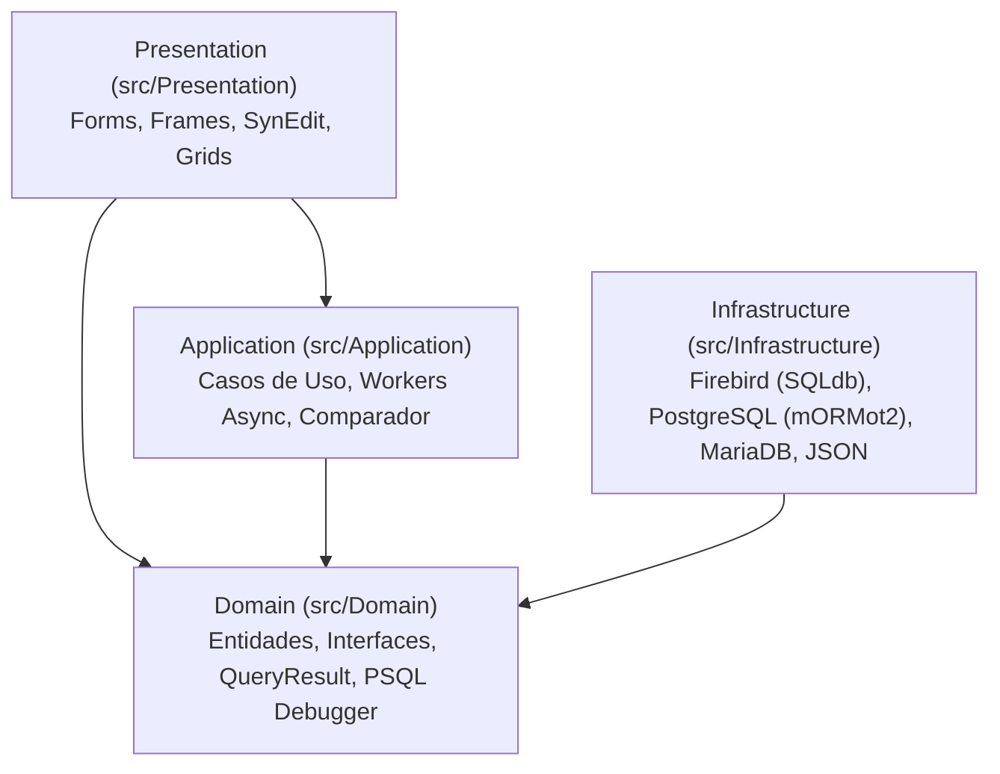

# Multi-DB SQL Editor

IDE e editor SQL multi-banco de alto desempenho inspirado no **IBExpert**, desenvolvido em **Free Pascal / Lazarus** com **mORMot2** e **Clean Architecture**, compatível com **Firebird (2.5 a 5.0)**, **PostgreSQL** e **MariaDB / MySQL**.

---

## Sumário

- [Bancos Suportados](#bancos-suportados)
- [Funcionalidades Principais](#funcionalidades-principais)
  - [1. Gerenciador de Conexões e Segurança por Ambiente](#1-gerenciador-de-conexões-e-segurança-por-ambiente)
  - [2. Explorador de Objetos (Árvore Lateral)](#2-explorador-de-objetos-árvore-lateral)
  - [3. Editor SQL Avançado](#3-editor-sql-avançado)
  - [4. Grid de Resultados e Manipulação de Dados](#4-grid-de-resultados-e-manipulação-de-dados)
  - [5. Plano de Execução Visual (Explain Plan) e Performance](#5-plano-de-execução-visual-explain-plan-e-performance)
  - [6. Editor Visual de Tabelas (Estilo IBExpert)](#6-editor-visual-de-tabelas-estilo-ibexpert)
  - [7. Debugger PSQL para Procedures Firebird](#7-debugger-psql-para-procedures-firebird)
  - [8. Database Comparer (Comparador de Schemas)](#8-database-comparer-comparador-de-schemas)
  - [9. Importar Dados (Import Data — Excel, CSV e TXT)](#9-importar-dados-import-data--excel-csv-e-txt)
  - [10. Busca Global nos Metadados e Gerenciador de Índices](#10-busca-global-nos-metadados-e-gerenciador-de-índices)
  - [11. Script Executive, Monitor, Manutenção e Replicação](#11-script-executive-monitor-manutenção-e-replicação)
- [Atalhos de Teclado](#atalhos-de-teclado)
- [Arquitetura do Projeto](#arquitetura-do-projeto)
- [Requisitos e Como Compilar](#requisitos-e-como-compilar)
- [Estrutura de Bibliotecas Cliente (Runtime)](#estrutura-de-bibliotecas-cliente-runtime)

---

## Bancos Suportados

| SGBD | Driver / Camada | Recursos Específicos |
| :--- | :--- | :--- |
| **Firebird (2.5 / 3.0 / 4.0 / 5.0)** | `SQLdb` (`TIBConnection`) com detecção automática de `fbclient.dll` por versão/arquitetura | Debugger PSQL passo a passo, `SET TERM`, contadores de I/O (`Indexed` vs `Natural`), `Services API` (Backup/Restore/Repair), Replicação Firebird 5 |
| **PostgreSQL** | `mORMot2` (`libpq.dll`) com cursor em *streaming* no servidor (`DECLARE CURSOR` + `FETCH`) | Conexão em nível de servidor (sem informar banco para listar todos os databases), seletor de Schema, `EXPLAIN (ANALYZE, BUFFERS, FORMAT JSON)`, Replicação Lógica (`PUBLICATION` / `SUBSCRIPTION`) |
| **MariaDB / MySQL** | `SQLdb` (`libmariadb.dll`) | Navegação de objetos, editor de tabelas, `EXPLAIN FORMAT=JSON`, comparador de schemas e importação/exportação |

---

## Funcionalidades Principais

### 1. Gerenciador de Conexões e Segurança por Ambiente
- **Cadastro completo (`connections.json`)** com suporte a *parser* automático de connection strings Firebird (`host/porta:caminho.fdb`), teste de conectividade, duplicação, ordenação alfabética e reordenação por *drag-and-drop* ou teclado (`Alt+↑` / `Alt+↓`).
- **Conexão PostgreSQL sem nome de banco (nível de servidor):** ao deixar o campo *Database* em branco no PostgreSQL, a conexão conecta ao banco de manutenção padrão (`postgres`) e permite expandir a árvore para visualizar e operar em **todos os bancos registrados** no servidor.
- **Seletor de Schema no PostgreSQL:** botão *Listar* no cadastro ou menu de contexto *Selecionar Schema* diretamente na árvore.
- **Cor de Alerta por Ambiente e Proteção de Produção:**
  - Perfis podem ser classificados como **Padrão**, **Desenvolvimento (Verde)**, **Homologação (Amarelo)** ou **Produção (Vermelho)**.
  - A árvore de conexões e a barra de ferramentas da aba SQL exibem a cor do ambiente.
  - Em conexões marcadas como **Produção**, comandos destrutivos (`DROP`, `TRUNCATE`, `DELETE` ou `UPDATE` sem cláusula `WHERE`) exigem confirmação explícita antes da execução.

### 2. Explorador de Objetos (Árvore Lateral)
- Organização agrupada por SGBD (**Firebird**, **PostgreSQL**, **MariaDB**) com nós expansíveis para **Bancos** (no PostgreSQL em nível de servidor), **Tabelas** (exibindo tamanho estimado em B/KB/MB/GB), **Views**, **Procedures / Functions**, **Triggers** e **Generators / Sequences**.
- **Filtro rápido** na árvore para localizar conexões, bancos ou objetos instantaneamente.
- **Menu de contexto completo:** abrir nova aba SQL, executar script, abrir monitor, comparar bases, manutenção, editar/ver DDL, visualizar dados, criar/excluir objetos, atualizar categoria e desconectar sessões ativas.
- **Exclusão de tabela com dupla confirmação (1/2 e 2/2):** previne exclusões acidentais (`DROP TABLE`) tanto pela árvore quanto pelo editor de tabelas ou tela de importação.

### 3. Editor SQL Avançado
- **Execução assíncrona em segundo plano** com cronômetro, barra de progresso e botão **Cancelar** sem travar a interface.
- **Paginação sob demanda (*Batch Fetch* / *Fetch All*)** com controle transacional (`Commit`, `Rollback`, `Auto Commit`).
- **Proteção de Memória RAM + *Disk Spill* (`Disco se faltar RAM`):**
  - Monitora o limite de RAM configurado por consulta (ex.: `128 MB`, `512 MB`, `2 GB` ou `Sem limite`) e a RAM livre do sistema operacional.
  - Quando **Disco se faltar RAM** está marcado, resultados grandes são transferidos transparentemente para arquivo temporário em disco (`multidb_spill_*.tmp`), liberando a RAM e mantendo a navegação fluida no grid.
  - Limpeza automática de quaisquer arquivos `.tmp` órfãos ao encerrar a aplicação.
- **Parâmetros Dinâmicos (`:parametro`):** ao executar consultas com parâmetros nomeados (`SELECT ... WHERE id = :id`), abre uma grade interativa para preenchimento (com suporte a `NULL` e memória dos valores digitados na sessão), ignorando casts `::` do PostgreSQL e atribuições `:=` de blocos PSQL.
- **Múltiplos Resultados e Abas Fixadas:**
  - Executar vários `SELECT`s separados por `;` abre automaticamente abas adicionais (`Resultado 2`, `Resultado 3`, ...).
  - Botão **Fixar** congela o resultado atual em uma aba independente para comparação antes/depois de alterações.
- **Autocompletar SQL sensível ao contexto (`Ctrl+Espaço`):** sugere tabelas, views, procedures e colunas respeitando aliases de tabelas (`FROM clientes c WHERE c.`).
- **Navegação `Ctrl+Click`:** clicar segurando `Ctrl` sobre o nome de uma tabela, view, procedure, trigger ou sequence abre diretamente o objeto correspondente.
- **Formatador SQL (`Alt+F`):** indenta e padroniza palavras-chave em qualquer editor SQL ativo.
- **Biblioteca de Snippets e Favoritos (`snippets.json`):** modelos prontos de diagnóstico e espaço para salvar consultas favoritas.
- **Histórico de Execução:** registra consultas executadas com data/hora, conexão, duração, status e erro, permitindo reabrir em nova aba.
- **Persistência de Workspace (`workspace.json`):** restaura abas abertas, SQL digitado, configurações de lote/RAM e layout da janela ao reabrir.

### 4. Grid de Resultados e Manipulação de Dados
- **Edição inline no grid** para consultas de tabela única (inserir linha, editar célula, definir `NULL`, excluir linha, com `Commit` e `Rollback`).
- **Filtro Rápido Local (`Ctrl+F`)** e opção de contexto **Filtrar por Valor desta Célula** para filtrar registros já carregados sem reconsultar o banco.
- **Inspetor Lateral de Valor / JSON e Visão Vertical do Registro:**
  - Painel lateral com formatação automática de **JSON** e leitura confortável de textos longos.
  - Aba **Visão Registro** exibindo `Campo | Tipo | Valor` na vertical para o registro selecionado.
- **Agregações Instantâneas na Seleção:** ao selecionar um intervalo de células no grid, exibe no rodapé `Contagem | Soma | Média | Mín | Máx`.
- **Geração de Scripts e Exportação Explícita (Registro Atual vs Consulta Inteira):**
  - **Registro Atual:** copiar TSV (com/sem cabeçalhos), CSV com cabeçalhos, `INSERT`, `UPDATE`, `UPDATE OR INSERT`, `JSON` e `Markdown`.
  - **Consulta Inteira** (executa `FetchAll` automaticamente para incluir todas as linhas pendentes): copiar CSV, gerar `INSERTs`, `UPDATEs`, `UPDATE OR INSERTs`, `JSON`, `Markdown` ou exportar para arquivo (`.csv`, `.sql`, `.json`, `.md`, `.html`).

### 5. Plano de Execução Visual (Explain Plan) e Performance
- Exibe tempos de *Prepare*, *Execute/Fetch*, uso de memória e estatísticas por tabela (**Leituras Indexadas** vs **Não-Indexadas / Natural**, destacando gargalos em vermelho).
- **Árvore Visual de Plano de Execução:**
  - **Firebird:** analisa o plano textual nativo e contadores de I/O.
  - **PostgreSQL / MariaDB:** botão **Plano Visual (EXPLAIN ANALYZE)** interpreta o plano JSON (`TExplainPlanParser`) destacando *Full Table/Seq Scans* e gargalos de ordenação/memória.

### 6. Editor Visual de Tabelas (Estilo IBExpert)
- **Campos:** adicionar, editar, excluir colunas e consultar dependências por campo.
- **Constraints e Índices:** visualização de `PK`, `FK`, `UNIQUE`, `CHECK` e criação/ativação/inativação/exclusão de índices.
- **Triggers:** árvore agrupada por evento (`BEFORE`/`AFTER`, `INSERT`/`UPDATE`/`DELETE`), editor com autocompletar PSQL/PLpgSQL, compilação com `F9` e abertura de função vinculada no PostgreSQL.
- **Dados:** consulta direta com limite configurável, campo **`WHERE:` com autocompletar automático de nomes de colunas** da tabela ao digitar (ou `Ctrl+Espaço`), edição inline transacional, **Exportar CSV** e **Importar Dados...**.
- **Dependências, DDL e Exclusão Segura:** visualização de objetos dependentes com navegação por duplo clique, DDL completo e botão **Excluir Tabela...** com dupla confirmação (`1/2` e `2/2`).

### 7. Debugger PSQL para Procedures Firebird
- Depuração passo a passo no cliente para *Stored Procedures* Firebird sem necessidade de agente no servidor:
  - **Step Into (`F7`)**, **Step Over (`F8`)**, **Continuar (`F9`)**, **Executar até o Cursor (`F4`)** e **Breakpoints (`F5` ou clique na margem)**.
  - Diálogo de preenchimento de parâmetros de entrada (`TProcedureParamsForm`).
  - Inspetor de **Variáveis e Parâmetros**, **Campos do Cursor atual**, tabela de resultados gerados por **`SUSPEND`** e **Log SQL** interno, com **Rollback automático** ao encerrar ou reiniciar.

### 8. Database Comparer (Comparador de Schemas)
- Compara a estrutura completa entre **Origem (Modelo)** e **Destino (Atualizar)** em lote: Generators/Sequences, Tabelas, Colunas (tipo, `NOT NULL`, `DEFAULT`, `COMPUTED BY`, comentários), PKs, Índices, FKs, `UNIQUE`, `CHECK`, Views, Procedures e Triggers.
- Ordenação topológica por dependência para evitar erros na criação/alteração de Views e Procedures.
- **Comparação visual DDL Origem vs Destino com destaque de diferenças linha a linha** (verde para linhas da Origem, vermelho para linhas do Destino, amarelo para linhas modificadas).
- Seleção granular das diferenças e execução do script de migração em **transação única** com *rollback* automático em caso de erro.

### 9. Importar Dados (Import Data — Excel, CSV e TXT)
- Ferramenta dedicada estilo IBExpert acessível pela aba **Dados** das tabelas, pelo menu **Ferramentas** ou pelo menu de contexto da árvore:
  - **Formatos suportados:** Excel **`.xlsx`** (leitura nativa sem precisar do Excel instalado), **`.xls`** (via OLE Excel ou texto/TSV) e **`.csv` / `.txt` / `.tsv`** (com separador, aspas e cabeçalho configuráveis).
  - **Tabela Existente ou Criar Nova Tabela:**
    - Ao marcar **Criar Nova Tabela**, infere automaticamente nomes de colunas válidos e tipos SQL (`INTEGER`, `BIGINT`, `NUMERIC(18,4)`, `VARCHAR(...)`, `BLOB SUB_TYPE TEXT` / `TEXT`) a partir dos dados.
    - Grade de **Mapeamento de Colunas** com duplo clique para editar nome destino, tipo de dado, chave primária (`PK`), coluna de origem no arquivo ou valor fixo/`NULL`.
  - **Modos de importação:** `INSERT`, `UPDATE OR INSERT / UPSERT` (`MATCHING` no Firebird, `ON CONFLICT DO UPDATE` no PostgreSQL, `ON DUPLICATE KEY UPDATE` no MariaDB) e `UPDATE`, além da opção *Limpar tabela antes*.
  - Pré-visualização dos dados, geração de script SQL na aba Log e execução com barra de progresso, *commit* por lote (`100` / `500` / `1000`) ou transação única.

### 10. Busca Global nos Metadados e Gerenciador de Índices
- **Busca Global nos Metadados e Código-Fonte (`Ctrl+Shift+F`):** pesquisa um termo simultaneamente em nomes de tabelas, colunas e dentro do código-fonte de *Views*, *Procedures* e *Triggers*, exibindo a linha encontrada e abrindo o objeto ao clicar.
- **Gerenciador de Índices e Estatísticas:** lista índices com seletividade (`RDB$STATISTICS` no Firebird), scans/tamanho (`pg_stat_user_indexes` no PostgreSQL) e cardinalidade (MariaDB), permitindo recalcular estatísticas individualmente ou em lote (`SET STATISTICS INDEX` / `ANALYZE`), ativar/inativar índices (Firebird) ou executar `REINDEX` / `OPTIMIZE`.

### 11. Script Executive, Monitor, Manutenção e Replicação
- **Script Executive (`Ctrl+F12`):** fila de execução de scripts SQL em lote com suporte a `SET TERM` no Firebird e modo **Executar fila direto do disco** para arquivos grandes sem carregar tudo na memória.
- **Monitor de Atividade:** visualiza conexões, transações e consultas ativas com filtro e ações para cancelar consultas ou encerrar sessões/PIDs.
- **Manutenção de Banco:** Backup, Restore e Validação/Reparo (Firebird Services API e utilitários PostgreSQL).
- **Assistente de Replicação:** configuração guiada de Replicação Lógica no PostgreSQL (`PUBLICATION` / `SUBSCRIPTION`) e recursos do Firebird 5.

---

## Atalhos de Teclado

| Atalho | Contexto | Ação |
| :--- | :--- | :--- |
| `F9` | Editor SQL / Editor de Objetos / Debugger | Executar SQL / Compilar DDL / Continuar Debug |
| `Ctrl+Espaço` | Editor SQL / Triggers / Campo `WHERE` (Dados) | Autocompletar SQL / Sugerir colunas da tabela |
| `Ctrl+Click` | Editor SQL | Abrir objeto sob o cursor (Tabela, View, Proc, Trigger, Sequence) |
| `Alt+F` | Qualquer editor SQL editável | Formatar / indentar código SQL |
| `Ctrl+F` | Grid de Resultados | Abrir barra de filtro rápido local |
| `Ctrl+Shift+F` | Janela Principal | Abrir Busca Global nos Metadados e Código-Fonte |
| `Ctrl+F12` | Janela Principal | Abrir Script Executive |
| `F7` / `F8` / `F4` / `F5` | Debugger PSQL (Firebird) | Step Into / Step Over / Até o Cursor / Alternar Breakpoint |
| `Alt+↑` / `Alt+↓` | Árvore de Conexões | Reordenar conexão selecionada |

---

## Arquitetura do Projeto

O código-fonte em `src/` segue **Clean Architecture** em 4 camadas (`Presentation -> Application -> Domain <- Infrastructure`):



Consulte [ARQUITETURA.md](ARQUITETURA.md) para detalhes de cada unit.

---

## Requisitos e Como Compilar

1. **Lazarus / Free Pascal** (`FPC 3.2.2+`, testado com `FPC 3.2.4` / `Lazarus 3.0+` no Windows x64).
2. **mORMot2:** baixe o repositório do `mORMot2` e mantenha os caminhos do pacote configurados no `.lpi` (ex.: `C:\Lazarus\ccr\mORMot2`).
3. Compilação via linha de comando:

```powershell
& "C:\Lazarus\lazarus\lazbuild.exe" MultiDbSqlEditor.lpi
```

- **Executável gerado:** `bin\MultiDbSqlEditor.exe`
- **Arquivos de configuração em runtime (pasta `bin\`):**
  - `connections.json` — perfis de conexão salvos
  - `workspace.json` — abas abertas e estado da janela
  - `snippets.json` — biblioteca de snippets e favoritos SQL
  - `comparer_settings.json` — últimos parâmetros do Database Comparer

---

## Estrutura de Bibliotecas Cliente (Runtime)

- **Windows (`win64` / `win32` com detecção automática de arquitetura):**
  - Firebird: `bin/clients/firebird/{2.5,3.0,4.0,5.0}/{win64,win32}/fbclient.dll` (e dependências)
  - PostgreSQL: `bin/clients/postgres/{win64,win32}/libpq.dll` (e dependências OpenSSL/iconv/intl)
  - MariaDB: `bin/clients/mariadb/{win64,win32}/libmariadb.dll`
- **Linux:** bibliotecas `.so` em `bin/clients/...` ou instaladas no sistema (`libfbclient2`, `libpq5`, `libmariadb3`).
